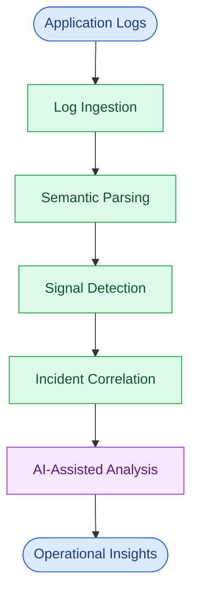
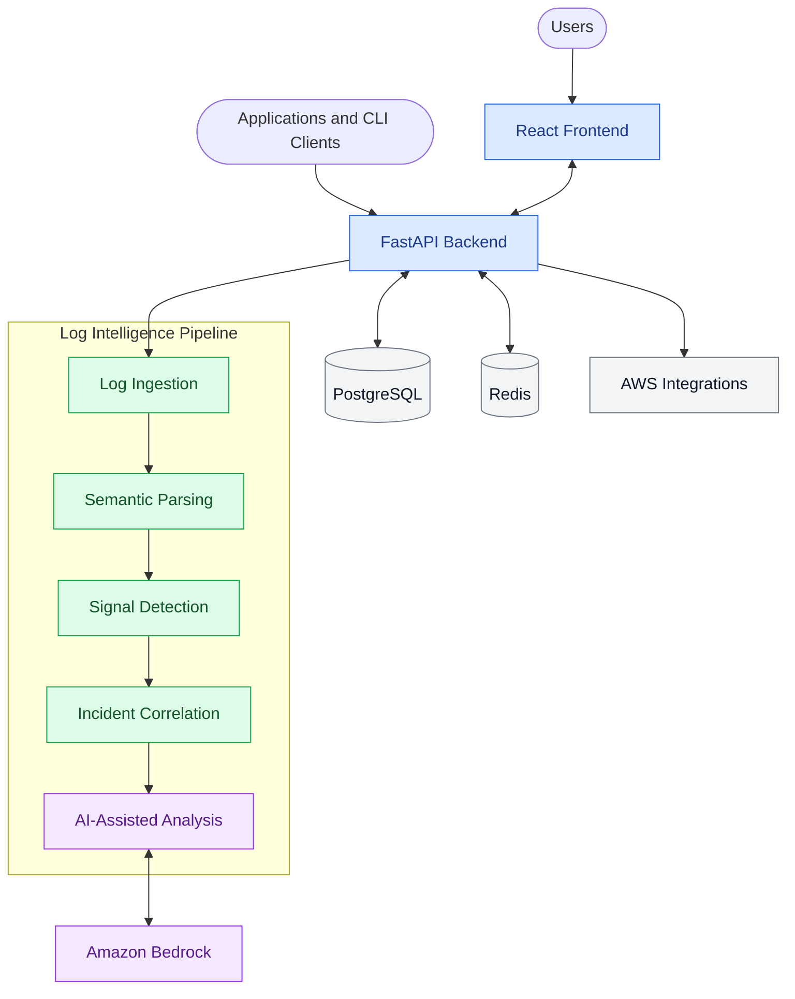

# SignalOps

**Turn application logs into actionable operational insights.**

SignalOps is an AI-powered application log intelligence platform designed to help developers understand application behavior, detect operational issues, and investigate incidents.

It transforms raw application logs into structured semantic events, identifies meaningful signals, correlates related events into incidents, and uses AI-assisted analysis to provide contextual insights.

## Overview

Traditional log management often requires developers to search through large volumes of raw log data to understand what went wrong.

SignalOps aims to simplify this process through a structured intelligence pipeline that combines deterministic processing with AI-assisted reasoning.

Key capabilities include:

- **Log ingestion** — Receive application logs from supported clients.
- **Semantic parsing** — Transform raw log records into structured events.
- **Signal detection** — Identify meaningful operational conditions.
- **Incident correlation** — Group related signals and events into incidents.
- **AI-assisted analysis** — Generate contextual insights using Amazon Bedrock.
- **Operational insights** — Help developers investigate application failures and understand potential causes.

## How It Works



SignalOps follows a **deterministic-first** approach: explicit parsing and detection logic handle predictable operations, while AI provides contextual interpretation where it adds value.

The pipeline represents the conceptual processing model rather than prescribing how individual stages are deployed or executed.

## Architecture at a Glance



The platform uses a React-based web interface, a FastAPI backend, PostgreSQL, Redis, and AWS integrations, including Amazon Bedrock.

For detailed component relationships, data flows, and deployment design, see the [architecture documentation](docs/architecture.md).

## Technology Stack

| Component | Technology |
|---|---|
| Frontend | React, Vite, React Router |
| State management | Redux Toolkit, TanStack Query |
| Styling | Tailwind CSS |
| Backend | Python, FastAPI |
| Database and migrations | PostgreSQL, SQLAlchemy, Alembic |
| Supporting infrastructure | Redis (optional during development) |
| Authentication | JWT, Google Identity Services (GIS) Sign-In |
| AI analysis | Amazon Bedrock |
| Email services | Amazon SES |
| Object storage | Amazon S3 |
| Containerization | Docker |
| Container image registry | Amazon Elastic Container Registry (Amazon ECR) |
| Cloud infrastructure | Amazon Web Services (AWS) |
| Testing and code quality | Pytest, Ruff, ESLint, Prettier |

## Repository Structure

```text
.
├── backend/
├── frontend/
├── docs/
├── README.md
├── CONTRIBUTING.md
└── SECURITY.md
```

## Getting Started

### Prerequisites

Ensure the following tools and services are available in your development environment:

- **Git** — To clone and manage the repository.
- **Python** — Use a version compatible with the backend dependencies.
- **Node.js** — Use a version compatible with the frontend dependencies.
- **PostgreSQL** — A running database instance for backend persistence.
- **Redis** — Optional for development; configure it if required by the features or workflows you want to run
- **AWS configuration** — Required for development workflows that use AWS integrations, such as Amazon Bedrock, S3 or SES.

Install the package manager specified by the frontend configuration if it differs from npm.

### Clone the Repository

```bash
git clone https://github.com/siddharthk8/SignalOps.git
cd SignalOps
```

### Configure the Environment

Before starting the application:

1. Follow the instructions in the [backend setup guide](backend/README.md) to configure the backend environment, including the PostgreSQL connection.
2. Follow the instructions in the [frontend setup guide](frontend/README.md) to configure the frontend environment.
3. Configure Redis only if needed for the development workflows you intend to use.
4. Configure AWS credentials and related settings.

Refer to the backend and frontend setup guides for the exact environment variables and configuration steps.

### Run the Application

Once the prerequisites are installed and both environments are configured, follow the backend and frontend READMEs for the exact commands.

## Project Documentation

| Document | Description |
|---|---|
| [Frontend documentation](frontend/README.md) | Frontend setup, configuration, development, and tooling |
| [Backend documentation](backend/README.md) | Backend setup, configuration, APIs, database, and development |
| [Architecture](docs/architecture.md) | System architecture, components, and data flows |
| [Contributing](CONTRIBUTING.md) | Contribution guidelines |
| [Security](SECURITY.md) | Security policy |

## Engineering Principles

- **Deterministic first:** Prefer predictable parsing and detection logic.
- **AI where it adds value:** Use AI for contextual reasoning rather than replacing deterministic processing.
- **Modular architecture:** Maintain clear boundaries between system responsibilities.
- **Structured events:** Build operational intelligence on normalized data.
- **Security and reliability:** Validate inputs, protect sensitive information, and handle failures explicitly.
- **Maintainability:** Favor clear interfaces, testable logic, and focused changes.

---

SignalOps turns application logs into structured signals, correlated incidents, and actionable operational understanding.
