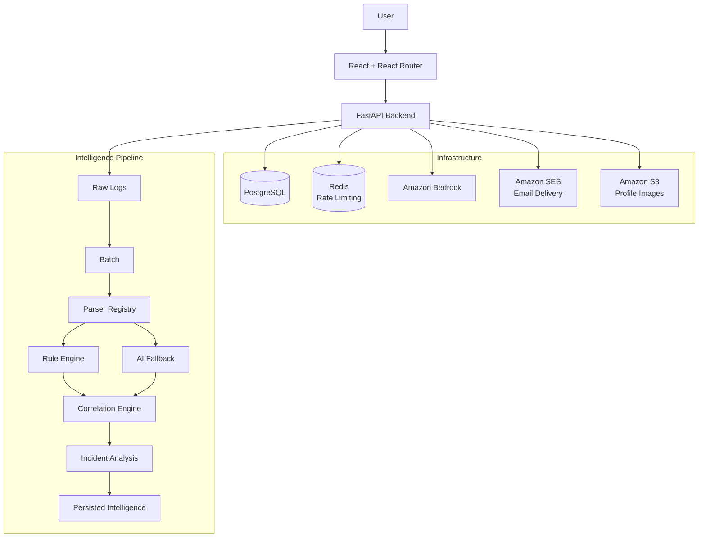

# SignalOps

**AI-powered application log intelligence for turning operational noise into actionable incident insight.**

SignalOps transforms heterogeneous application logs into **semantic events**, detects operational signals, correlates related activity into **incidents**, and uses **Amazon Bedrock** to generate operational analysis.

> **Stop reading logs. Start understanding systems.**

---

## Overview

SignalOps is an application-focused log intelligence platform built around a simple idea:

**Turn raw application output into structured operational understanding.**

```text
  ┌──────────────┐
  │   Raw Logs   │
  └──────┬───────┘
         │
         ▼
┌──────────────────┐
│ Semantic Events  │
└────────┬─────────┘
         │
         ▼
┌──────────────────┐
│     Signals      │
└────────┬─────────┘
         │
         ▼
┌──────────────────┐
│    Incidents     │
└────────┬─────────┘
         │
         ▼
┌──────────────────┐
│   AI Analysis    │
└──────────────────┘
```

The pipeline follows a **deterministic-first approach**: known log formats and predictable operational patterns are handled through explicit parsers and rules. AI is introduced where semantic uncertainty or higher-level operational reasoning benefits from it.

---

## Architecture



### Core Design Principle

**Raw logs are evidence. Semantic events are the foundation for intelligence.**

Raw logs are preserved for auditing and investigation, while downstream detection and correlation operate on normalized events rather than raw log strings.

---

## Key Capabilities

* Application log ingestion and persistence
* Registry-based semantic parsing
* AI-assisted fallback parsing for unknown formats
* Rule-based operational signal detection
* Context-aware incident correlation
* Amazon Bedrock-powered incident analysis
* Operational dashboards and investigation views
* JWT authentication and Redis-backed rate limiting

---

## Technology Stack

| Area               | Technology                      |
| ------------------ | ------------------------------- |
| **Backend**        | FastAPI, Python                 |
| **Data**           | PostgreSQL, SQLAlchemy, Alembic |
| **API**            | REST, OpenAPI                   |
| **Frontend**       | React, Vite                     |
| **State**          | Redux Toolkit, TanStack Query   |
| **Styling**        | Tailwind CSS                    |
| **AI**             | Amazon Bedrock                  |
| **Infrastructure** | Docker, Redis                   |
| **AWS Services**   | Bedrock, SES, S3                |
| **Testing**        | Pytest                          |
| **Tooling**        | Ruff, ESLint, Prettier          |

---

## Repository Structure

```text
SignalOps/
├── backend/          # FastAPI backend and intelligence pipeline
├── frontend/         # React application and generated API client
├── docs/             # Architecture, ERD, screenshots, and project documentation
├── CONTRIBUTING.md
├── SECURITY.md
└── README.md
```

---

## Quick Start

SignalOps consists of a FastAPI backend and a React frontend.

### Backend

See the **[Backend README](backend/README.md)** for complete setup and configuration instructions.

```bash
cd backend

pip install -r requirements.txt
alembic upgrade head
uvicorn main:app --reload
```

The API is available at:

```text
http://127.0.0.1:8000
```

### Frontend

See the **[Frontend README](frontend/README.md)** for complete setup and development instructions.

```bash
cd frontend

npm install
npm run dev
```

> **Configuration:** Backend environment variables and local configuration are documented in the [Backend README](backend/README.md).

---

## Engineering Approach

### Deterministic First
Known formats and predictable scenarios are handled through explicit parsers and rules.

### AI Assisted
AI is used for semantic uncertainty and operational reasoning rather than replacing deterministic logic.

### Semantic Core
Detection and correlation operate on normalized events, providing a consistent foundation for downstream intelligence.

### Modular Design
Ingestion, parsing, detection, correlation, persistence, and AI analysis are separated into focused stages.

---

## Project Status

SignalOps is an actively developed engineering project exploring the combination of **semantic event processing, deterministic detection, incident correlation, and generative AI** for application-focused observability.

---

## Documentation

| Resource                              | Description                                               |
| ------------------------------------- | --------------------------------------------------------- |
| [Backend README](backend/README.md)   | Backend setup, architecture, API, migrations, and testing |
| [Frontend README](frontend/README.md) | Frontend setup, architecture, API client, and development |
| [Architecture](docs/architecture.md)  | Detailed system architecture and design decisions         |
| [Contributing](CONTRIBUTING.md)       | Contribution guidelines                                   |
| [Security](SECURITY.md)               | Security policy                                           |
