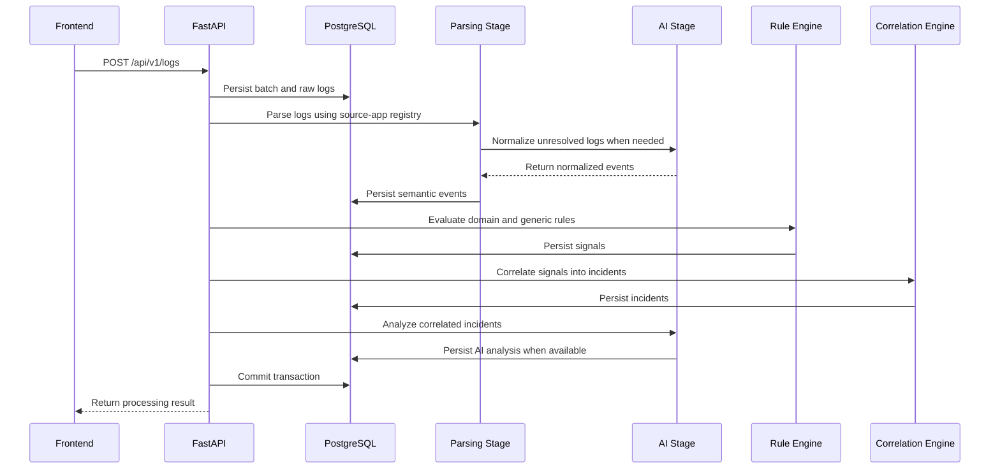

# Backend

The SignalOps backend is a FastAPI application responsible for authentication, source application management, log ingestion, incident correlation, AI-assisted analysis, and the APIs consumed by the frontend.

It follows a modular monolith architecture, separating HTTP endpoints, business workflows, log-processing logic, and database access into dedicated modules.

## Architecture Overview

The main components are organized as follows:

- `main.py` — Application entry point.
- `api/` — Versioned API routers and HTTP endpoints.
- `domains/` — Business workflows, services, and domain schemas.
- `engine/` — Log parsing, rule evaluation, signal detection, incident correlation, and AI analysis.
- `db/` — SQLAlchemy models, repositories, and database session management.
- `core/` — Configuration, logging, exceptions, and rate limiting.
- `schemas/` — Shared data schemas.
- `enums/` — Shared enumerations.
- `shared/` — Common constants and utilities.
- `workers/` — Background processing tasks, including SES feedback handling.

The API layer handles HTTP requests and delegates business operations to domain services. The engine processes logs through dedicated pipeline stages, while repositories manage database access.

## Configuration

Backend configuration is managed through environment variables.

Before running the application, review `core/config.py` to understand how configuration is loaded and where to place the development `.env` file.

Use `.env.example` as a reference for the available configuration variables. Keep local environment files, credentials, and other secrets out of version control.

## Running Locally

1. Review `core/config.py` to identify the expected location and loading behavior of the development `.env` file.
2. Create your local configuration using `.env.example` as a reference.
3. Ensure PostgreSQL is running and the database connection settings are configured correctly.
4. Install dependencies, apply database migrations, and start the application.

```bash
cd backend
pip install -r requirements.txt
alembic upgrade head
uvicorn main:app --reload
```

The API is available at `http://127.0.0.1:8000` by default.

## Database and Migrations

SignalOps uses SQLAlchemy with an asynchronous database engine and session management. Alembic manages database schema migrations, and PostgreSQL is the expected database for local development.

Apply migrations with:

```bash
cd backend
alembic upgrade head
```

## API Overview

API routes are mounted under `/api/v1`.

The main API areas include:

- **Authentication:** Login, token refresh, logout, password reset, and session revocation.
- **Users:** Account creation, profile management, password changes, and account deletion.
- **OAuth:** Google sign-in and account linking.
- **Source applications:** Application registration, token management, and batch listing.
- **Logs and batches:** Log ingestion and batch retrieval.
- **Incidents:** Incident management and resolution.
- **Dashboard:** Summary metrics for the authenticated user.

For the implemented routes and HTTP methods, refer to `api/v1/endpoints/`.

## Ingestion Pipeline

The pipeline begins when a user posts a batch of logs to `/api/v1/logs`.



The pipeline is organized into dedicated stages under `engine/pipeline/stages/`, coordinated by `engine/pipeline/orchestration.py`.

Its main responsibilities are:

1. **Parsing:** Registered parsers extract structured information from incoming logs.
2. **AI fallback:** Unresolved logs can be normalized using the AI-backed fallback parser.
3. **Rule evaluation:** Domain-specific and generic rules identify signals.
4. **Correlation:** Related signals are grouped into incidents.
5. **AI analysis:** Correlated incidents are analyzed to generate additional insights.
6. **Persistence:** Pipeline results are stored for retrieval through the API.

Parsing logic and patterns are located under `engine/parsing/`, while correlation and incident analysis are implemented under `engine/correlation/` and `engine/ai/`.

## Authentication and Data Access

The backend uses JWT access tokens and refresh tokens stored in hashed form.

Token-version checks support session invalidation, including operations such as password changes and logging out all sessions. Protected endpoints use authentication dependencies and ownership checks to restrict access to user-owned resources.

## Testing

Backend tests are located in `backend/tests/` and use `pytest`.

Run the test suite with:

```bash
cd backend
pytest
```

Tests may cover authentication, user management, source applications, log ingestion, batch retrieval, incident resolution, and dashboard functionality, depending on the implemented test suite.
