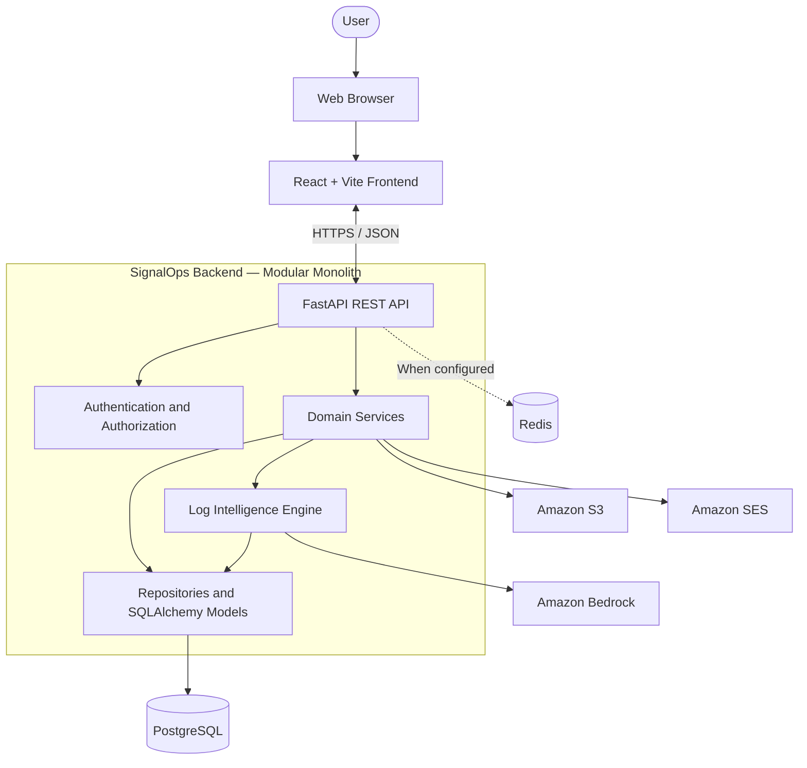
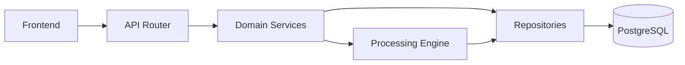
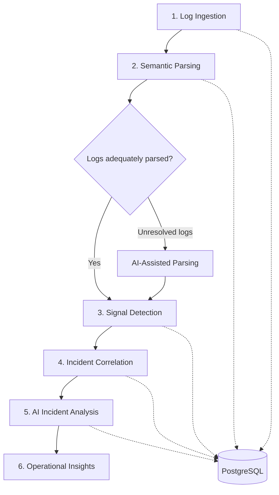
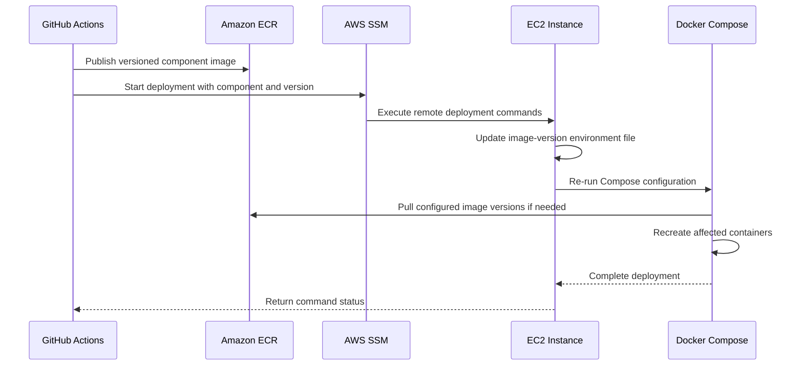

# SignalOps Architecture

SignalOps is an AI-powered application log intelligence platform that transforms raw application logs into structured events, operational signals, correlated incidents, and actionable insights.

The application follows a **modular monolith architecture**. A React frontend communicates with a FastAPI backend, which owns business workflows, log processing, authorization, and persistence. Deterministic parsing, detection rules, and correlation logic handle predictable processing, while Amazon Bedrock supports AI-assisted parsing and incident analysis.

Application delivery is automated through GitHub Actions. Frontend and backend container images are published separately to Amazon Elastic Container Registry (Amazon ECR), then deployed to an EC2 instance using AWS Systems Manager (SSM) and Docker Compose.

This document describes the application's architecture, processing lifecycle, data ownership, and deployment workflow. For implementation details and local setup, see the [backend README](../backend/README.md) and [frontend README](../frontend/README.md).

## 1. System Overview

The main architectural boundaries are:

- **Frontend:** Displays dashboards, source applications, log batches, and incidents.
- **API layer:** Exposes versioned HTTP endpoints and coordinates requests.
- **Domain layer:** Implements business workflows, including authentication, user management, source applications, and incident operations.
- **Processing engine:** Parses logs, detects signals, correlates incidents, and invokes AI capabilities.
- **Persistence layer:** Stores application data and processing results in PostgreSQL.
- **External services:** Provide AI analysis, object storage, and email delivery through AWS.

Redis supports configured functionality such as rate limiting. It is optional during development when the workflows being tested do not require it.

## 2. Application Architecture

SignalOps separates responsibilities into logical modules while retaining a unified backend application. Its primary request path is:

This is a conceptual request flow. Authentication, profile management, dashboard retrieval, and other non-ingestion operations can use domain services and repositories without invoking the processing engine.

### Frontend

The frontend is a React single-page application built with Vite.

| Technology | Responsibility |
|---|---|
| React and React Router | UI rendering and navigation |
| Redux Toolkit | Client-side state, including authentication state |
| TanStack Query | Server-state caching and request lifecycle |
| Tailwind CSS | Styling |
| Vite | Development server and build tooling |

The frontend consumes the backend REST API. Route guards improve the user experience, but authorization and business rules are enforced by the backend.

### Backend

The FastAPI backend is organized into the following layers:

| Layer | Responsibility |
|---|---|
| `api/` | Versioned HTTP routes, request validation, and responses |
| `domains/` | Business workflows and domain-specific operations |
| `engine/` | Parsing, rule evaluation, correlation, and AI analysis |
| `db/` | SQLAlchemy models, repositories, and database access |
| `core/` | Configuration, logging, exception handling, and rate limiting |
| `schemas/`, `enums/`, `shared/` | Shared data contracts, classifications, constants, and utilities |
| `workers/` | Background worker entry points, including SES feedback processing |

See the [backend README](../backend/README.md) for the internal module structure and implementation details.

## 3. Log Intelligence Pipeline

The processing engine is central to SignalOps. It transforms raw logs into structured events, detects operational signals, correlates related signals into incidents, and generates contextual analysis.

### Processing stages

1. **Log ingestion:** Accept incoming logs and associate them with a batch and source application.
2. **Semantic parsing:** Use the parser registry and source-specific parsers to normalize logs into structured events.
3. **AI-assisted parsing:** Use the configured fallback parser for logs that cannot be adequately resolved through conventional parsing.
4. **Signal detection:** Evaluate parsed events against source-specific and generic rules to identify meaningful operational signals.
5. **Incident correlation:** Identify relationships among signals and group related activity into incidents.
6. **AI incident analysis:** Use Amazon Bedrock to generate contextual analysis and structured operational insights.
7. **Persistence and presentation:** Store processing results and expose them through the API for frontend consumption.

The pipeline follows a **deterministic-first, AI-assisted** strategy. Explicit parsing patterns, detection rules, and correlation logic provide predictable behavior; AI handles selected interpretation and analysis tasks.

The diagram describes the logical processing lifecycle, not a guarantee that every stage executes in a single database transaction.

## 4. Data Architecture and Authorization

PostgreSQL is the primary relational database. SQLAlchemy models represent persistent entities, repositories encapsulate database access, and Alembic manages schema migrations.

The main data concepts include:

- **Users and authentication:** User accounts, OAuth accounts, refresh tokens, password-reset tokens, and related authentication data.
- **Source applications and batches:** Application sources and the batches used to organize ingested logs.
- **Events and signals:** Structured application activity and detected operational conditions.
- **Incidents:** Correlated signals representing related operational issues.
- **AI analyses:** Contextual analysis associated with supported processing and incident workflows.
- **Supporting records:** Entities, relationship records, and email suppression data.

### Data ownership

The backend is the authority for access control.

- Source applications are scoped to their owners.
- Batch access must respect source-application ownership.
- Incident data and dashboard metrics must be restricted to authorized user resources.
- Mutations must verify authorization before modifying records.
- Token validation and invalidation must be enforced by backend logic.

Frontend route guards and hidden UI controls do not replace backend authorization.

## 5. Authentication and External Integrations

### Authentication

SignalOps supports JWT-based application authentication and Google Identity Services (GIS) Sign-In.

The frontend provides the sign-in experience, while the backend handles authentication workflows, application token issuance and validation, refresh, revocation, and authorization. Google sign-in and linked OAuth account workflows are handled by the backend's OAuth functionality.

### AWS services

| Service | Purpose |
|---|---|
| Amazon Bedrock | AI-assisted parsing and contextual incident analysis |
| Amazon S3 | Object storage for supported workflows, including profile images |
| Amazon SES | Email delivery and feedback processing |
| Amazon ECR | Storage and distribution of frontend and backend container images |
| Amazon EC2 | Hosts the deployed application containers |
| AWS Systems Manager (SSM) | Enables deployment workflows to execute remote deployment operations on the EC2 instance |

External integrations use environment-specific configuration and appropriate AWS permissions. Tests that do not require live AWS services it use mocks.

## 6. CI/CD and Deployment Architecture

SignalOps uses GitHub Actions to validate releases, publish container images to Amazon ECR, and deploy updates to EC2. The frontend and backend use separate images, allowing their versions to be managed independently.

### Deployment Workflow

After an image is published, the deployment workflow receives the component name, image version, and source commit SHA.

1. Connects to EC2 through AWS Systems Manager (SSM).
2. Updates the environment file containing frontend and backend image versions.
3. Reruns Docker Compose to apply the configured versions.

The environment file controls which image versions are deployed, so updating one component does not inherently require updating the other.

### Deployment responsibilities

| Component | Responsibility |
|---|---|
| GitHub Actions | CI, release validation, image publishing, and deployment orchestration |
| Amazon ECR | Stores versioned frontend and backend images |
| AWS Systems Manager | Executes remote deployment operations on EC2 |
| EC2 | Hosts the application containers |
| Environment file | Specifies the frontend and backend image versions used by the deployment |
| Docker Compose | Applies the configured container image versions and service configuration |

The deployment workflow uses restricted IAM permissions and protect production credentials and configuration. Container tags and release metadata is validated before deployment.

## Related Documentation

- [Backend README](../backend/README.md) — Backend setup, module structure, and implementation details.
- [Frontend README](../frontend/README.md) — Frontend setup, routing, state management, and implementation details.
- [Project README](../README.md) — Product overview, technology stack, prerequisites, and getting started.
- [Contributing Guidelines](../CONTRIBUTING.md) — Contribution workflow and development expectations.
- [Security Policy](../SECURITY.md) — Security reporting and related guidance.
