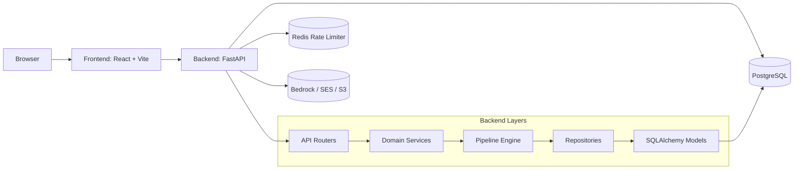
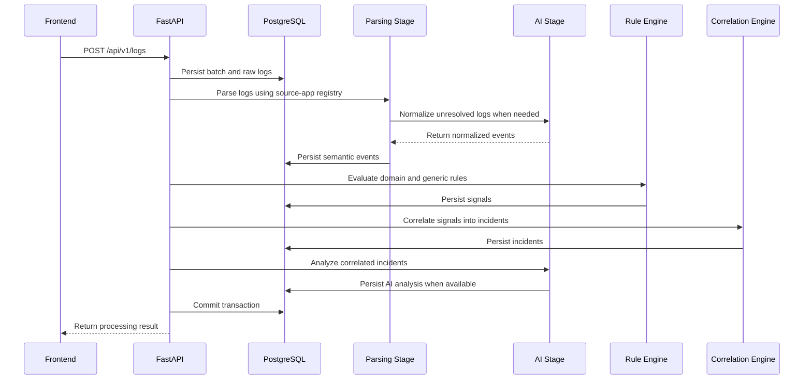
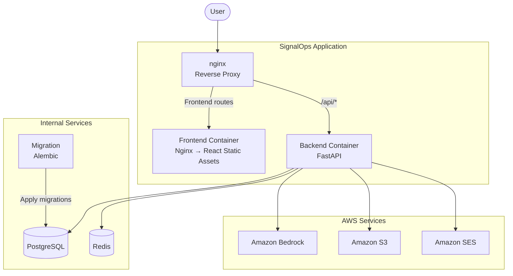

# SignalOps Architecture

SignalOps is a hybrid DDD-style modular monolith. The backend owns the domain workflow and persistence boundaries, while the frontend is a route-driven React application that consumes the generated OpenAPI client.

## System Overview

## Backend Architecture

### Entry Point And Request Lifecycle

- `backend/main.py` creates the FastAPI application, installs CORS and security headers, registers exception handlers, and mounts the versioned router under `/api/v1`.
- Requests are handled by thin HTTP endpoints in `app/api/v1/endpoints`.
- Domain-specific service modules encapsulate business rules and authorization-sensitive data access.
- Repositories own persistence logic and compose SQLAlchemy queries.

### Core Building Blocks

- `app/core/config.py` loads environment-specific settings from `~/.config/signalops/backend`.
- `app/core/rate_limiter` applies IP-based and user-based token-bucket limits using Redis.
- `app/core/exceptions.py` normalizes validation and HTTP errors into a consistent JSON shape.
- `app/db/core.py` creates the async SQLAlchemy engine and session dependency.
- `app/db/models` contains the persistent entities.
- `app/db/repositories` contains read/write helpers for each aggregate.

### Domains

- `auth` handles login, refresh, logout, password recovery, and token invalidation.
- `user` manages account creation, profile updates, password changes, and profile images.
- `source_app` owns source application CRUD and pagination.
- `batch` returns the full batch view used by the detail screen.
- `dashboard` computes aggregate metrics for the overview page.
- `incident` exposes incident resolution.

## Ingestion Pipeline

The pipeline begins when a user posts a batch of logs to `/api/v1/logs`.

### Stage Details

1. **Ingestion** — Raw logs are persisted against a batch record.
2. **Parsing** — The parser registry selects a source-application-specific parser for each log.
3. **AI Fallback** — Unresolved logs are sent to the Bedrock-backed fallback parser and normalized into semantic events.
4. **Detection** — Semantic events are evaluated by source-specific and generic rules to generate signals.
5. **Correlation** — Related signals are correlated into incidents.
6. **Incident Analysis** — Correlated incidents are analyzed by AI to produce structured operational insight.
7. **Persistence** — Events, signals, incidents, and available AI analyses are persisted, and the transaction is committed after successful pipeline execution.

If the AI analyzer does not return a structured analysis, the pipeline still produces a deterministic informational analysis so the UI can present a consistent result.

## Frontend Architecture

### Shell And Routing

- `frontend/src/main.jsx` defines the browser router.
- `Layout` provides the shared page chrome and error handling.
- Public routes are guarded by `PublicRoute`; authenticated routes are guarded by `ProtectedRoute`.
- `DashboardLayout` hosts the authenticated application shell.

### State And Networking

- Redux Toolkit stores the authenticated user state.
- TanStack Query caches server state and controls retry behavior.
- `frontend/src/api` is generated from the backend OpenAPI document.
- `VITE_API_URL` controls the API base URL during development and build time.

## Data Ownership And Authorization

Every user-scoped read or mutation verifies ownership before returning or changing data.

- Source apps belong to a specific user.
- Batches are only readable by the owning source-app user.
- Incidents and dashboard metrics are filtered to the current user.
- Auth tokens are invalidated through token version checks and refresh-token revocation.

## Deployment Topology

SignalOps runs as a containerized deployment managed through Docker Compose.

The public `nginx` container terminates TLS and routes requests based on the URL path. `/api/*` requests are forwarded to FastAPI, while all other requests are served by the frontend container.

## Testing Strategy

The backend test suite exercises the main workflows end to end:

- account creation and login
- refresh/logout and password reset
- source app CRUD
- log ingestion and batch retrieval
- dashboard metrics
- incident resolution

The tests rely on transactional database fixtures and AWS mocks so the pipeline can be validated without external infrastructure.
